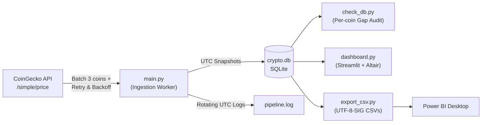

# Crypto Price Data Pipeline

An end-to-end automated time-series data pipeline that ingests multi-coin cryptocurrency prices from the CoinGecko REST API, stores UTC-standardized snapshots in SQLite, monitors data quality and gaps, and presents insights through a Streamlit dashboard and Power BI CSV exports.

---

## Architecture



---

## Key Engineering Features

- **Batched Multi-Coin Ingestion (`main.py`):** Fetches `bitcoin`, `ethereum`, and `solana` in a single HTTP request to conserve API rate limits, with input normalization (`.lower()`), `timeout=5`, and response validation (`raise_for_status()` + missing-coin warning handling).
- **Resilient Retry & Exponential Backoff:** Retries only transient failures (`429`, `5xx`, `ConnectionError`, `Timeout`) with `5s -> 10s` backoff; fails fast on non-retryable client errors and returns exit codes (`0` / `1`) for scheduler observability.
- **UTC Standardization & Safe Migrations:** All timestamps in `crypto.db` and `pipeline.log` are stored in **UTC**. Historical local-time (`UTC+7`) rows were diagnosed and safely migrated via idempotent scripts (`fix_timezone.py`, `fix_timezone2.py`) with pre-change backups and `WHERE` safeguards.
- **Observability & Data Quality:**
  - `RotatingFileHandler` (`1 MB x 3 backups`, UTF-8) prevents unbounded log growth.
  - `check_db.py` audits per-coin row counts, daily coverage, missing-data gaps (`> 20 min`), and timestamp regressions (`< 0 min`).
- **Analytics & BI Layer:**
  - `dashboard.py` uses SQL CTEs and Window Functions (`LAG() OVER (PARTITION BY coin_name ORDER BY timestamp)`) to compute snapshot-over-snapshot `% change`, hourly OHLC-style summaries, and pipeline health metrics in Thai time (`UTC+7`) at display time.
  - `export_csv.py` generates Power BI–ready CSV datasets (`crypto_snapshots.csv` and `crypto_hourly.csv`).
- **24/7 Cloud Automation:** Scheduled via `.github/workflows/pipeline.yml` (runs every 15 minutes on GitHub Actions) as well as local Windows Task Scheduler (`CryptoPrice`).

---

## Database Schema (`price_snapshot`)

| Column | Type | Description |
|---|---|---|
| `id` | `INTEGER PRIMARY KEY AUTOINCREMENT` | Unique snapshot ID |
| `coin_name` | `TEXT` | Lowercase coin identifier (e.g. `bitcoin`, `ethereum`, `solana`) |
| `price` | `REAL` | Spot price in target currency |
| `currency` | `TEXT` | Quote currency (`usd`) |
| `timestamp` | `DATETIME` | Snapshot timestamp in **UTC** (`YYYY-MM-DD HH:MM:SS`) |

---

## Project Structure

| File | Purpose |
|---|---|
| `main.py` | Production ingestion script (API batch fetch, retry/backoff, UTC SQLite load, rotating logging) |
| `check_db.py` | Data quality & per-coin gap audit script |
| `dashboard.py` | Interactive Streamlit + Altair dashboard (UTC+7 display, hourly summary, log health) |
| `export_csv.py` | Exports snapshot & hourly summary CSVs for Power BI |
| `fix_timezone.py` / `fix_timezone2.py` | One-off idempotent UTC migration scripts for early local-time records |
| `.github/workflows/pipeline.yml` | GitHub Actions cron workflow for 24/7 collection |
| `requirements-pipeline.txt` | Lightweight runtime dependency for automated ingestion |
| `requirements.txt` | Full dependencies (ingestion + dashboard) |

---

## Quick Start

### 1. Setup Environment
```powershell
python -m venv .venv
.\.venv\Scripts\python.exe -m pip install -r requirements.txt
```

### 2. Run Pipeline Once
```powershell
.\.venv\Scripts\python.exe main.py
```

### 3. Run Data Quality Audit
```powershell
.\.venv\Scripts\python.exe check_db.py
```

### 4. Launch Streamlit Dashboard
```powershell
.\.venv\Scripts\streamlit.exe run dashboard.py
```

### 5. Export Data for Power BI
```powershell
.\.venv\Scripts\python.exe export_csv.py
```
Then open Power BI Desktop -> **Get Data** -> **Text/CSV** and select the files in `exports/`.

---

## Real-World Data Incidents Diagnosed

1. **10-Day Collection Gap (Nov 5 – Nov 15, 2026):** Local Windows Task Scheduler (`Interactive only`, `No Start On Batteries`) only runs while the laptop is powered on and logged in. This motivated migrating scheduled collection to GitHub Actions for 24/7 execution.
2. **420-Minute (7-Hour) Timezone Jumps:** Gap auditing revealed two `420 min` / `421 min` jumps caused by manual local-time (`UTC+7`) inserts mixing with UTC scheduler rows. Diagnosed via `check_db.py`, backed up, and corrected with row-scoped idempotent SQL updates (`fix_timezone2.py`), followed by upgrading `check_db.py` to detect negative timestamp regressions per coin.
